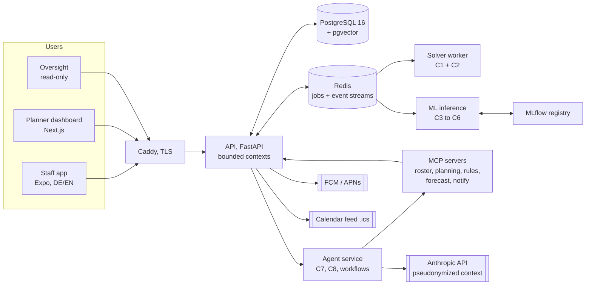
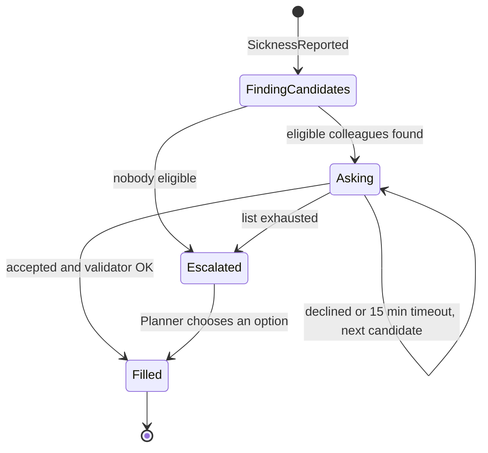
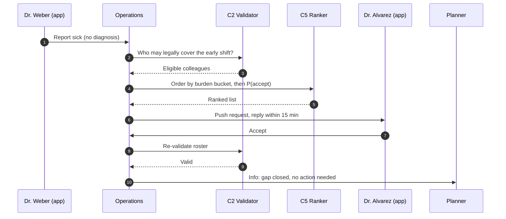

# DienstPilot: System Architecture and Technical Design

KI-gestützte Dienstplanung für Kliniken / AI-assisted duty scheduling for hospitals
Version 0.2, October 2026. Companion to `PROCESS.md` (how the product is used) and `UI_SPEC.md` (screens).

> **Project status.** DienstPilot is a portfolio project, designed together with a physician. The prototype runs on a synthetic five-year dataset for a fictional department, "Klinik für Innere Medizin, Klinikum Musterstadt". No real hospital, patient or staff data is used. The status table below is updated only when a component is actually built and tested; all metrics are produced by the scripts in `eval/`.

| # | Component | Kind | Status |
|---|---|---|---|
| — | Process design (roles, approvals, monthly cycle) | Domain design | Done, with clinical input |
| — | System architecture (this document) | Design | Done |
| — | Synthetic data generator (`synthdata/`) | Simulation | Prototype |
| — | Events (outbox, Redis Streams, idempotent consumers, versioned schemas), hash-chained audit trail, durable workflows with demo-time timers, month-end report (`backend/src/dienstpilot/shared/`, `audit/`, `workflows/`; ADR-016, ADR-017) | Application | Built & tested on synthetic data (backend tests; one consumer so far; narrative text is a placeholder until C8) |
| — | HTTP API for the screens (`backend/src/dienstpilot/app/`, stand-ins for C7 and C8), job worker | Application | Prototype |
| C1 | Roster Optimizer (`engine/solver/`) | Constraint optimization | Built & evaluated on synthetic data (`eval/results/benchmark.json`) |
| C2 | Rule and Compliance Validator (`engine/validator/`) | Deterministic | Built & evaluated on synthetic data (`eval/results/c2.json`) |
| C3 | Absence Forecaster (`ml/`) | ML, time series | Built & evaluated on synthetic data (`eval/results/c3.json`). The served model is the seasonal-naive baseline: the LightGBM challenger did not meet the promotion rule (model card) |
| C4 | Preference Learner (`ml/`) | ML, Bayesian | Built & evaluated on synthetic data (`eval/results/c4.json`). The served model is the raw per-person-rates baseline: the hierarchical learner did not meet the promotion rule (model card) |
| C5 | Cover Acceptance Ranker (`ml/`) | ML, classification + policy | Built & evaluated on synthetic data (`eval/results/c5.json`). The served model is the base-rate baseline: the LightGBM learner did not meet the promotion rule, so inside a burden bucket the order follows hours against contract (model card) |
| C6 | Leave Feasibility Surrogate (`ml/`) | ML, simulation-trained classification | Built & evaluated on synthetic data (`eval/results/c6.json`). The served model is the logistic-regression baseline: the LightGBM learner did not meet the promotion rule. Advisory hint only; the solver's answer is the one shown (model card) |
| — | MCP servers (`mcp_servers/`: roster, planning, rules, forecast, notify) | Application | Built & tested on synthetic data (backend and mcp tests; thin wrappers over the REST API, ADR-018) |
| — | Rulebook retrieval, RAG (`agents/`, `agents/rag/`) | Retrieval | Built & evaluated on synthetic data (`eval/results/rag.json`, 60 questions written for the prototype). Hybrid retrieval did not beat vectors alone (pre-registered check failed), so vectors alone are served; hybrid is a setting (model card `rag-rulebook.md`) |
| C7 | Request Intake Agent (`agents/`, `backend/.../engines/c7.py`) | LLM, structured output | Built & evaluated on synthetic data (`eval/results/c7.json`). **The keyword stand-in is served:** the language model (`claude-haiku-5-5`) failed one pre-registered check (it followed an injected instruction once), so it is not promoted and the model was not switched (model card `c7-request-intake.md`) |
| C8 | Planner Copilot | LLM agent, MCP tools, RAG | Designed |
| — | Staff app and planner dashboard | UI prototype | Designed |
| — | Pilot with a clinic | Validation | Not started |

---

# Part I: DienstPilot in plain language

## 1. The problem

In most hospital departments, one senior physician builds the monthly duty roster by hand. It takes the better part of a weekend, every month. Wishes arrive by e-mail, WhatsApp and sticky note. When someone calls in sick at 06:40, the same physician spends the morning on the phone instead of with patients. And because nobody can see how nights and weekends are distributed, the roster is a constant source of friction and a known reason people leave.

## 2. The idea

Think of DienstPilot as a careful colleague with four skills, none of whom is allowed to make the final decision.

The **rulebook keeper** knows every hard rule (rest periods, maximum hours, night-shift limits, required qualifications) and never bends one. The **planner's calculator** can try millions of combinations in a minute and find the rosters that grant the most wishes while sharing nights and weekends fairly. The **memory of the department** has learned how this department actually behaves: that absences rise in February, that a request for cover at 06:45 on a Sunday is answered differently from one on a Tuesday afternoon. And the **interpreter** turns all of this into plain German or English: why a plan looks the way it does, which rule a change would break, what a request would cost.

Only the responsible physician can approve and publish a roster. The system never orders anyone to take a shift; it asks.

## 3. Why the parts are separate

Building a roster is, at its core, a puzzle with rules that must never be broken. That job goes to a mathematical optimizer, which either finds a plan that satisfies every rule or proves that none exists. Machine learning is good at estimating things that are uncertain, such as how many people are likely to be absent next week, so that is where it is used. Language models are good at language, so they read free-text requests and explain results. Keeping these jobs apart is what makes the system trustworthy: a guess can never become a broken rule, and a sentence can never become a shift assignment.

## 4. What it costs to run

One department runs on a single server hosted in Germany plus a small amount of language-model usage. The estimate in §16 puts the total in the range of a modest monthly software subscription. The design target is that the senior physician reviews and approves in about twenty minutes instead of building for a weekend; that figure is a hypothesis until it is measured in a pilot (§17).

---

# Part II: Technical design

## 5. Design principles

1. **Right tool per job.** Optimization for feasibility and assignment, ML for uncertain estimates, LLMs for language. Never mixed (ADR-001).
2. **Human-in-the-loop by construction.** Write paths that change a published roster require an `Approval` entity, or a policy approval the Planner configured. Agents have no publish tool (ADR-004).
3. **Two keys for safety.** Every plan is checked by a validator implemented independently of the solver.
4. **Loose coupling.** Modular monolith with enforced bounded contexts, event-driven integration, ports and adapters around every external dependency (ADR-002).
5. **Reproducibility.** Rule sets, model versions, prompt versions and solver configs are versioned, and each roster run records the versions that produced it.
6. **Privacy by design.** Pseudonymous IDs in ML and LLM paths, no diagnosis data, aggregate-only absence forecasting (ADR-003).
7. **Deterministic first.** An LLM is called only where the input or output is natural language.

## 6. System context

## 7. Bounded contexts

| Context | Owns | Publishes events |
|---|---|---|
| Identity and Access | users, roles (Staff, Staff+, Planner, Oversight, Admin), department scope; SSO via OIDC | `UserProvisioned` |
| Organization and Rules | departments, staff, contracts, qualifications, shift types, demand templates, versioned rule sets | `RuleSetActivated` |
| Requests | availability, preferences, leave requests, request windows | `RequestWindowOpened`, `PreferencesSubmitted`, `LeaveRequested`, `LeaveDecided` |
| Planning | roster runs, variants, approvals, publication | `RosterGenerated`, `VariantApproved`, `RosterPublished`, `RosterChanged` |
| Operations | swaps, sickness, cover cascades | `SwapOffered`, `SwapAutoApproved`, `SwapEscalated`, `SicknessReported`, `CoverRequested`, `CoverAccepted`, `CoverEscalated` |
| Fairness and Reporting | burden ledger, compliance reports, payroll export | `MonthClosed` |
| Notifications | push, in-app, e-mail digests | — |
| Audit | append-only, hash-chained event log | — |
| Intelligence | feature pipelines, model serving (C3–C6) | `ForecastUpdated` |
| Assistant | agents (C7, C8), workflows, RAG | `ProposalCreated` |

Contexts never read each other's tables. Cross-context reads use public query services or read models built from events. Boundaries are enforced in CI with import-linter contracts, which is what makes later extraction into separate services cheap. The eight contexts from Identity to Audit live in `backend/src/dienstpilot/`; Intelligence lives in `ml/`, and Assistant in `agents/` and `mcp_servers/`.

## 8. Data architecture

**Store.** One PostgreSQL 16 instance with one schema per context, plus pgvector for retrieval. Redis holds job queues (arq) and event streams. Datasets are identified by the generator's `manifest.json` (seed, generator version, a SHA-256 per file), and eval results record the hashes of the files they read (ADR-012; DVC is not used). Model artefacts are tracked and registered with MLflow.

**Core entities.** `Staff`, `Contract` (hours band, start/end), `Qualification`, `ShiftType` (start, end, hours, burden weight), `ShiftDemand` (date × shift type × qualification → required count), `RuleSet` (versioned, `effective_from`), `RequestWindow`, `Preference`, `LeaveRequest`, `RosterRun` (inputs + versions), `RosterVariant`, `Assignment`, `Approval`, `SwapOffer`, `Absence`, `CoverCascade`, `CoverOffer`, `Proposal`, `BurdenLedgerEntry`, `AuditEvent`, `ModelVersion`.

**Rules as data.** Rules are typed, declarative records (`min_rest_hours`, `max_consecutive_nights`, `max_weekends_per_month`, `max_on_call_per_month`, `contract_hours_band`, `qualification_mix`), not code. The solver compiles them into constraints; the validator interprets them directly. Values follow the department's legal and collective-agreement framework (for example, the 11-hour rest period of §5 ArbZG) and are configured by the Administrator, never hard-coded.

**Audit trail.** Every event is appended with `hash = sha256(prev_hash ‖ canonical_json(event))`, in order of a sequence number, in one chain per department plus one for events without a department (ADR-016). The seeded history is chained too. A verifier runs nightly (a timer, ADR-017) and on demand; W10 shows "Protokoll vollständig und unverändert" only when a check actually passed. Oversight can export the log with the hashes.

**Events.** Written to an outbox table in the same transaction as the state change, relayed to Redis Streams, consumed idempotently (event IDs deduplicated per consumer). Schemas are JSON Schema files with explicit versions; breaking changes create a new version and both are consumed during migration.

### 8.1 Synthetic dataset

Because the prototype uses no real data, the generator in `synthdata/` is a first-class component.

- **Department:** Klinik für Innere Medizin, Klinikum Musterstadt (fictional). About 28 physicians: 1 Chefärztin, 4 Oberärzt:innen, 7 Fachärzt:innen, 16 Assistenzärzt:innen, with rotations, arrivals and departures over time.
- **Period:** January 2021 to December 2025, daily granularity, for training and evaluation. 2026 is a separate demo period (marked in `manifest.json`, not for training): January to October simulated the same way, November 2026 published, the December 2026 request window open on the demo date.
- **Shift types:** Frühdienst, Spätdienst, Nachtdienst, Bereitschaftsdienst (weekend and holiday), plus Rufbereitschaft for Oberärzt:innen and the Chefärztin.
- **Demand:** weekday and weekend templates, holiday adjustments, qualification mix per shift.
- **Absences:** seasonal respiratory waves (winter peaks), school-holiday leave peaks, post-night-shift effects at department level, random noise.
- **Behaviour:** each synthetic physician has latent preferences (weekday × shift type), a latent cover willingness that decays with recent load, and swap habits.
- **Historical rosters:** produced by a simulated "manual planner" heuristic (greedy, with realistic imperfections such as uneven weekend distribution) so the optimizer has a baseline to be compared against.
- **Ground truth:** the latent parameters are written to a separate `_truth/` folder that training code is forbidden to read. Evaluation code uses it to check whether models recover the structure they were meant to learn.

- **Rules:** two rule-set versions (`2021-1`, and `2026-1` from 1 January 2026), so roster runs show which version they were planned under.

All generator assumptions are documented in `synthdata/ASSUMPTIONS.md`, and the dataset is reproducible from a seed. The output is Parquet in `data/synthetic/v1/` with a manifest (seed, generator version, row counts, hashes); `make seed` loads it into Postgres through each context's models (ADR-007).

---

## 9. The intelligence layer: eight components

| # | Component | Kind | Answers the question | Can change the roster? |
|---|---|---|---|---|
| C1 | Roster Optimizer | CP-SAT | Which valid roster is best? | Proposes variants only |
| C2 | Rule and Compliance Validator | Deterministic | Does this plan break any rule? | No (gatekeeper) |
| C3 | Absence Forecaster | Gradient boosting / GLM | How many absences should we expect per day? | No |
| C4 | Preference Learner | Hierarchical Bayesian | What does this person probably prefer? | No (suggestions the person confirms) |
| C5 | Cover Acceptance Ranker | Calibrated classifier + fairness policy | Whom should we ask first? | No |
| C6 | Leave Feasibility Surrogate | Simulation-trained classifier | Is this leave request likely coverable? | No |
| C7 | Request Intake Agent | LLM, structured output | What did this person mean? | No |
| C8 | Planner Copilot | LLM agent with MCP tools and RAG | Why does the plan look like this, and what if…? | Creates proposals only |

### C1: Roster Optimizer (Dienstplan-Optimierer)

**Method.** Google OR-Tools CP-SAT. Boolean decision variables `x[d,t,s]`: physician `d` works shift `s` on day `t`.

**Hard constraints** (never violated):
- coverage: for each day, shift and qualification, assigned qualified physicians ≥ required count
- at most one shift per physician per day
- minimum rest between consecutive shifts (pairs that would violate it are forbidden)
- maximum consecutive night shifts; maximum weekends and on-call duties per period
- approved leave and declared unavailability
- contract hours within the configured band (planned hours plus leave credit; hours above the contract, up to the band's upper edge, count as overtime and are penalized)
- the free day after Bereitschaftsdienst, Rufbereitschaft only alongside a Frühdienst, and promised trade-offs (at least *n* weekends with duty for a person, from an approved leave with "Mit Tausch beantragen")

**Soft objectives** (weighted sum, minimized):
- unmet wishes, with "important" wishes weighted higher
- fairness: spread between the highest and lowest weighted burden, where burden = year-to-date ledger + this month's nights, weekends and holidays at configurable weights
- overtime hours
- isolated single night shifts
- changes relative to a prior draft (stability when re-planning)

**Variants.** Two or three plans per run, each from a different weight profile ("wishes first", "zero overtime", "balanced") plus a diversity constraint requiring a minimum Hamming distance from earlier variants, so the planner sees genuinely different trade-offs. Each variant carries a metrics object (wish rate, burden spread, overtime, per-person deviations), which is what C8 phrases into the plain-language summary.

**Infeasibility.** Constraint groups are guarded by assumption literals. When no plan exists, CP-SAT's sufficient-assumptions-for-infeasibility returns a small conflicting set, which is translated into a sentence such as "Not coverable: 23 Dec late shift needs two internists, only one is available after approved leave."

**Evaluation.** Solve time, optimality gap, zero hard violations (checked by C2), and comparison with the manual-planner baseline on wish rate, burden spread and overtime (§17.1). The recommended ("balanced") profile's weights are chosen on July to December 2024 only (`eval/tune_profiles.py` → `eval/results/tuning.json`); 2025 is held out.

**Implementation.** `engine/solver/` (`dienstpilot_solver`). Runs stop at a deterministic time budget with interleaved multi-thread search and a fixed seed, and the model is built in a fixed order, so the same inputs give the same rosters on any machine; a test solves in two processes with different hash seeds. Runs execute in the arq worker (ADR-009). A CI property test checks that every solver output on perturbed real months passes C2.

### C2: Rule and Compliance Validator (Regelprüfung)

A pure function `validate(roster, ruleset) → list[Violation]`, implemented independently of the solver from the same declarative rules (N-version safety). It runs on every solver output, on every drag-and-drop in the planner editor (target: under 50 ms for a month), on every swap and cover acceptance, and before any write to a published roster.

**Tests.** Hypothesis property tests: every solver output validates clean; every randomly mutated plan that breaks a rule is caught; violation messages exist in DE and EN for every rule type.

**Implementation.** `engine/validator/` (`dienstpilot_validator`), with no dependency on the solver (import-linter). Times are real Europe/Berlin timestamps, so rest periods across a daylight-saving change are exact. Each violation is an i18n key with parameters plus a fix (`violation.*`, `fix.*` in `packages/i18n`). `validate_change` re-checks only the people and days a change touches, for live editing. `eval/run_validator_eval.py` compares it with the generator's independent checker on every published month and on seeded random changes and measures latency (`eval/results/c2.json`).

### C3: Absence Forecaster (Ausfallprognose)

**Job.** Expected number of absences per department per day, 1 to 42 days ahead, with a prediction interval. Feeds the coverage-health view and the recommendation to schedule reserve capacity on high-risk days.

**Method.** Seasonal-naive and Poisson/negative-binomial GLM baselines; LightGBM with Poisson objective as the challenger. Intervals via quantile models or split conformal prediction.

**Features.** Day of week, month, holidays, school holidays, seasonal respiratory-illness index (in a real deployment, public aggregate surveillance data), department headcount, aggregate night-shift load in prior days.

**Evaluation.** Rolling-origin time-series cross-validation (never random splits); MAE and Poisson deviance against baselines; empirical coverage of the 80 % interval.

**As built (Phase 8a).** Direct multi-horizon model on department × day counts, horizon as a feature. Features (one definition in `ml/src/dienstpilot_ml/features/absence.py`): weekday, month, day-of-year harmonics, public and school holidays, absence levels over the last 7, 28 and 91 days, the same weeks of the previous year, night shifts of the last 7 days. Two inputs of the design were not used: the respiratory-illness index (it exists only in the generator's ground truth, which training must not read) and department headcount (28 positions are always filled, so it is constant). Intervals are split-conformal (80 %, scaled residuals per horizon bucket, calibrated on the out-of-fold forecasts of 2024). Training uses 2021 to 2024 with six expanding rolling-origin folds; 2025 is the held-out test. The promotion rule was committed before the first fit. The served model is whatever holds the registry alias `champion` (a committed bundle); `eval/results/c3.json` says which model that is and why. Ports and adapter: `AbsenceForecaster` takes a `ForecastContext` whose `as_of` is the demo clock.

**Guardrail.** Aggregate only. Individual absence prediction is out of scope by design: it would be health-data profiling, it would not survive works-council review, and it is not needed to plan reserves (ADR-003).

### C4: Preference Learner (Wunschprofil)

**Job.** Suggest likely preferences in the request window ("You often swap away Monday late shifts. Add as a preference?").

**Method.** Hierarchical Beta-Binomial model per physician × (weekday, shift type) over stated wishes and kept-versus-swapped-away events, with empirical-Bayes shrinkage toward the department mean so new staff get sensible defaults.

**Evaluation.** Held-out log-likelihood against a pooled baseline; on synthetic data, rank correlation between learned and true latent preferences.

**Guardrail.** Suggestions only. Nothing reaches the solver until the person confirms it; the feature can be switched off per person. When it is off, nothing is computed for that person. Inferred preferences are visible to the person only: computed on their own request from their own history, never stored, never returned to the Planner or Oversight. The committed bundle holds department-level rates only.

**Status.** Built and evaluated on synthetic data under `ml/preference_learner/PROMOTION_RULE.md` (committed before any fitting): the result file `eval/results/c4.json` and the model card `docs/model-cards/c4-preference-learner.md` say which model is served and why (ADR-013).

### C5: Cover Acceptance Ranker (Vertretungsvorschlag)

**Job.** Order eligible colleagues for a cover request so that gaps close quickly without always burdening the same willing people.

**Model.** LightGBM classifier for P(accept), calibrated with isotonic regression. Features: hours versus contract this month, days since last cover, shifts in the last seven days, notice period, shift type, weekday, time of request, confirmed preference score from C4. Excluded: age, gender, nationality, family status, absence history.

**Policy (separate from the model).** Candidates first come from C2 (qualified, rested, within hours). They are bucketed by cover burden; buckets are contacted least-burdened first, and P(accept) only orders candidates within a bucket. Each candidate gets a 15-minute window before the cascade moves on.

**Evaluation.** Brier score, ROC-AUC and expected calibration error on the held-out 2025, against a base rate and a logistic regression; an offline replay of the 2025 sick calls (`eval/`) compares time to fill, cover-burden Gini, escalation rate and people asked per filled gap for the fairness-first policy with the champion, the previous stand-in ordering and a naive "ask the most reliable person" policy.

**Status.** Built and evaluated on synthetic data under `ml/cover_ranker/PROMOTION_RULE.md` (committed before any fitting): the result file `eval/results/c5.json` and the model card `docs/model-cards/c5-cover-ranker.md` say which model is served and why (ADR-014). The probability is never returned to anyone.

### C6: Leave Feasibility Surrogate (Urlaubs-Schnellprüfung)

**Job.** Tell a physician within milliseconds, before submitting, whether a leave request is likely coverable.

**Method.** Labels are the answers of the product's own M5 check (C1 with C2: the same function the check job runs, `dienstpilot_solver.coverability`) for a few thousand simulated leave requests, drawn against the department's historical states of 2021 to 2025. Half of the states are as they were; half have extra leave piled on (counterfactual, labelled as simulated: the real planner stops approving at six concurrent, so real states almost never contain a "no"). Candidates are the previous rule, logistic regression and LightGBM on features describing the request window: daily coverage slack, overlapping approved and pending leave, qualification slack, holidays and school holidays, length, notice, the requester's role and qualifications. The classes are coverable, coverable with a trade-off and not coverable; because the trade-off class is rare, a pre-registered rule turns the target binary (plain coverable against the rest) when it is under 5 % of the training rows.

**Authority.** The surrogate only drives the instant hint. The incremental solver run confirms the answer within seconds, produces any concrete trade-off ("coverable if you take one extra weekend in June"), and its answer is the one the screen shows. Every disagreement is logged (an audit event without a name); a disagreement never changes what is shown.

**Evaluation.** Precision of the "coverable" class (the costly error is a false yes) at a recall at least the previous rule's, hint latency, agreement rate with the solver. Results lead with the natural states, then the stress states, then the pooled mix, which is always labelled "including simulated stress states".

**Status.** Built and evaluated on synthetic data under `ml/leave_surrogate/PROMOTION_RULE.md` (committed before any label was generated or model fitted): the result file `eval/results/c6.json` and the model card `docs/model-cards/c6-leave-feasibility.md` say which model is served and why (ADR-015). The probability is never returned to anyone.

### C7: Request Intake Agent (Wunsch-Assistent)

**Job.** Turn free text or dictation in German or English ("lieber Nächte als Wochenenden, und am 14.12. kann ich nicht") into a typed `PreferenceSet`.

**Method.** `claude-haiku-5-5` with a forced tool call whose input schema is the `PreferenceSet` (structured output), validated with Pydantic and deterministic filters. A dated "rather not this shift" is a soft `avoid_shift_days` entry, never a hard `unavailable` day (a soft turned into a hard block counts as a hard error in the promotion rule). It is served only if the pre-registered rule (`agents/intake/PROMOTION_RULE.md`) says so; otherwise the keyword stand-in stays and says so. Ambiguities come back as one clarifying question. The person sees the parsed result and confirms before anything is saved.

**Guardrails.** Reasons are not stored (data minimization). A deterministic filter and the prompt both ensure no health information is extracted or kept. Input is delimited and treated as data, never as instructions.

**Evaluation.** 200 synthetic utterances (DE and EN, 60 dev and 140 test, exact labels by construction), a pre-registered rule with seven checks (`agents/intake/PROMOTION_RULE.md`), results in `eval/results/c7.json` and the model card. Result: the model failed one check and is not served.

### C8: Planner Copilot (Planungs-Assistent)

**Job.** A side panel in the planner dashboard that explains variants, answers questions ("Why does Dr. Weber have three weekends?"), runs what-ifs, cites rules, and drafts change reasons and announcements.

**Method.** LangGraph agent on `claude-haiku-5-5` (Haiku for both agents: the phase has a hard budget of 5 euros; if C8 fails its pre-registered gates the stand-in stays, and the model is not changed afterwards). All data access goes through MCP tools (§10); there is no raw SQL. Rule questions go through RAG (§11). Variant summaries are generated from C1's metrics object.

**Guardrails.**
- No approve or publish tool exists. The agent can create `Proposal` records that appear in the planner's inbox.
- Numeric grounding check: every number in a generated summary must match a value in the source metrics, or the templated fallback text is shown instead.
- Staff free text that reaches the context is delimited and treated as untrusted.
- Tool access mirrors the user's role: Oversight users get read-only tools.

**Evaluation.** A suite of 50 planner tasks with exact numeric checks and rubric grading, refusal tests (asking it to publish), and prompt-injection tests embedded in synthetic staff comments.

### 9.1 Deterministic workflows (deliberately not LLM agents)

| Workflow | Trigger | Behaviour |
|---|---|---|
| Sick-call cascade | `SicknessReported` | C2 finds eligible colleagues → C5 policy orders them → ask one at a time with 15-minute deadline → on accept, re-validate and update → escalate to Planner with ranked options if exhausted or if the only options involve overtime, external locum, or another department |
| Swap approval | `SwapAccepted` | C2 re-validates both rosters; valid → auto-approve and notify Planner; invalid → escalate with the reason |
| Request window | `RequestWindowOpened` | push to all staff; reminders at configurable intervals; progress shown to Planner |
| Month-end | `MonthClosed` | hours, overtime, rest compliance, burden distribution, decision trail → payroll export and Oversight report; C8 writes a short narrative over the computed figures |

Workflows are durable state machines persisted in Postgres (`workflow.instance`, `workflow.timer`). Timers are rows due in demo time; an arq cron on the worker, the API handlers and `PUT /demo/clock` fire what has become due, in order and exactly once, so a restart never loses a cascade in progress (ADR-017). Redis only wakes the worker up. The four workflows are persisted; the month-end narrative is a placeholder until C8.

---

## 10. MCP layer

Each MCP server is a small module with its own ASGI app (the dev stack runs the five in one `mcp` service) using the Streamable HTTP transport. In the demo the bearer token is the user's demo-login token, checked by the API and passed on with every call; the tool list depends on the role (ADR-018). Real OAuth with audience-bound tokens is designed, not built. Tools declare annotations (`readOnlyHint`, `destructiveHint`, `idempotentHint`) and typed output schemas.

| Server | Tools | Notes |
|---|---|---|
| `roster` | `get_roster`, `get_assignments_for`, `get_burden_ledger`, `get_coverage` | read-only |
| `planning` | `run_what_if(changes)`, `validate(changes)`, `create_proposal(changes, reason)` | proposals land in the Planner inbox; no publish tool exists |
| `rules` | `search_rules(query)`, `get_rule(id)` | retrieval with citations (§11; vectors served) |
| `forecast` | `get_absence_forecast(range)`, `get_cover_candidates(shift_id)` | wraps C3 and C5 |
| `notify` | `draft_announcement(audience, text)` | drafts only; sending requires a human click |

The agent service is an MCP client. The same servers can be connected to other MCP clients later (for example, a hospital's own assistant) without changing the backend.

## 11. Retrieval (RAG) over the rulebook

**Corpus.** The official ArbZG text, a synthetic example works agreement (Betriebsvereinbarung), synthetic department SOPs and a rule summary written from the seeded rule set. No collective-agreement text: it is copyrighted, and the summary says so. Each document carries a version and a retrieval date; synthetic ones are labelled in the document and in every citation.

**Pipeline.** Structure-aware chunking along legal paragraphs (§, Absatz) so a citation always points at a real unit of text; bge-m3 multilingual embeddings served locally (the int8 ONNX export on ONNX Runtime), so documents never leave the server; hybrid retrieval (Postgres full-text + pgvector with reciprocal rank fusion) was built and evaluated, but vectors alone beat it, so vectors alone are served and hybrid is a setting (`RAG_RETRIEVAL`; no reranker is built); answers must cite § and version, and the copilot says it cannot find a source rather than answer without one.

**Evaluation.** Recall@k and citation correctness on a labelled question set (DE and EN), `eval/results/rag.json`, with a rule written before the run (`agents/rag/EVAL_RULE.md`). Result: vectors alone beat the hybrid fusion on these questions and are what is served (model card, W13). Faithfulness grading of answers comes with C8.

## 12. Loose coupling: how updates stay safe

| Change | Why nothing else breaks |
|---|---|
| New Claude model version | LLM provider sits behind a port; model is config; eval suites gate the switch |
| Retrained ML model | Served by registry alias (`champion`); challenger runs in shadow mode first; rollback is an alias flip |
| New collective-agreement rule | Rules are versioned data; solver and validator both read the new version; old rosters keep their version |
| New consumer of an event | Subscribes to the stream; producers are unaware of it |
| Event schema change | New schema version; both versions consumed during migration |
| Extracting a context into its own service | Already isolated by import-linter contracts and event-based integration |
| Database change | Expand → migrate → contract migrations |
| Risky feature | Behind a feature flag, enabled per department |

## 13. ML engineering (MLOps)

- **Data:** synthetic datasets identified by the manifest hashes the generator writes (training re-checks every file it reads against them; results record them); no DVC (ADR-012). Features are defined once in `ml/src/dienstpilot_ml/features/` and imported by both training and serving to prevent train/serve skew.
- **Splits:** strictly temporal (train on earlier months, evaluate on later ones); no random splits on time-dependent data.
- **Tracking:** every run logged to a local MLflow (SQLite store, `make train`) with parameters, metrics, the data manifest hash and the code commit. The API never imports MLflow: it loads a committed bundle written at promotion.
- **Promotion gate:** the rule is written down and committed before the run (C3: `ml/absence_forecast/PROMOTION_RULE.md`). A model is promoted to the registry alias `champion` only if it beats its best baseline on the held-out period by that rule and passes the calibration checks; the result is written to `eval/results/`. Otherwise the baseline stays champion.
- **Model cards:** one per model in `docs/model-cards/` (intended use, out-of-scope uses, data, metrics, limitations, fairness considerations).
- **Monitoring:** feature drift (population stability index), calibration drift for C5, solver-agreement rate for C6, business KPIs; retraining after each monthly cycle.

## 14. Software engineering

- **Stack:** Python 3.12, FastAPI, Pydantic v2, SQLAlchemy 2, Alembic; Next.js and Expo in TypeScript; OpenAPI-generated client shared by both apps.
- **Testing:** unit tests; property-based tests for C1/C2; contract tests for event schemas; Playwright end-to-end tests for the leave, swap and sick-call flows; agent eval suites in CI on prompt changes.
- **CI/CD:** GitHub Actions running lint, type checks, import-linter, tests and evals; container images built and deployed to the VPS via Docker Compose; migrations run as a release step.
- **Observability:** OpenTelemetry traces across API, workers and agents; Prometheus metrics; Grafana dashboards; Loki logs. LLM calls are logged to an append-only ledger file (tokens, cost, run id; never prompt text) that the budget guard and `eval/cost_model.py` read, with OpenTelemetry spans (ADR-018, ADR-020).
- **Architecture decision records** in `docs/adr/`:
  - ADR-001 Constraint optimization, not ML, for roster assignment
  - ADR-002 Modular monolith with enforced boundaries before microservices
  - ADR-003 Aggregate-only absence forecasting
  - ADR-004 Agents create proposals; no approve or publish tools
  - ADR-005 Self-hosted embeddings for the rulebook
  - ADR-012 C3 serving, the promotion rule, and dataset identity without DVC
  - ADR-013 C4 serving, the person-only privacy boundary, and the same promotion convention
  - ADR-016 Event outbox, Redis Streams, idempotent consumers and the audit hash chain
  - ADR-017 Durable workflows and timers due in demo time
  - ADR-018 MCP servers as REST wrappers, the usage log instead of Langfuse, and the key in .env
  - ADR-019 The rulebook: corpus, chunking, local embeddings, hybrid retrieval and how CI runs without the model
  - ADR-020 A hard budget for paid calls, three LLM modes, and when C7 serves the model

## 15. Security and compliance

- **Hosting:** a single VPS in a German data centre; encrypted disks; encrypted off-site backups with regular restore drills.
- **Access:** OIDC single sign-on, role-based and department-scoped access, least privilege for services, secrets encrypted in the repo (sops + age).
- **GDPR:** employee data processed for the employment relationship; data minimization throughout. The fact of being sick is health data, so absence records hold only status and dates, are visible as "absent" to colleagues, and follow a short retention period.
- **LLM calls:** only pseudonymous, minimal context leaves the server; names are re-attached in the UI; no diagnosis or reason text is ever sent.
- **Works council:** scheduling and technical systems that can monitor staff are subject to co-determination (§87 (1) Nr. 2 and Nr. 6 BetrVG). The Oversight role, full transparency of the logic, the absence of individual performance scoring, and a template Betriebsvereinbarung are designed for that review.
- **EU AI Act:** AI used to allocate work in an employment context is likely to fall under the Act's high-risk employment use cases. The design treats it that way: human oversight at every consequential step, automatic logging, documented models, and plain-language explanations.

## 16. Infrastructure and cost estimate

| Item | Estimate per department per month |
|---|---|
| VPS in Germany, 8 vCPU / 32 GB (all services) | roughly €40–90 depending on provider and plan |
| Backups and object storage | roughly €5 |
| LLM usage (intake, copilot, summaries) | estimated 2–4 million tokens; computed by `eval/cost_model.py` against current API pricing |
| Push notifications | provider free tiers |

These are planning estimates; `eval/cost_model.py` recomputes them from measured token usage once the agents run.

## 17. Evaluation

### 17.1 Benchmark on synthetic data

`eval/run_benchmark.py` compares the manual-planner baseline with C1 on held-out months and writes `eval/results/benchmark.json`. The table below is rendered from that file. Violations in published rosters and in in-month changes are counted separately: the manual baseline's in-month rate follows from a simulation parameter (`synthdata/ASSUMPTIONS.md` §13), so it is not a finding about real planners.

<!-- benchmark:start -->
*Generated by `eval/render_tables.py` from `eval/results/benchmark.json` (12 held-out months, 2025-01 to 2025-12; dataset seed 20261020, generator 1.3.0; solver c1-1.0.1, validator c2-1.0.0). Do not edit by hand.*

| Metric | Manual baseline | DienstPilot (C1) |
|---|---|---|
| Hard-rule violations, published rosters (counted by C2) | 5 | 0 |
| Hard-rule violations, in-month changes (simulation parameter, see note) | 43 | — |
| Wishes granted | 39.6% | 62.8% |
| Important wishes granted | 41.0% | 63.9% |
| Weighted-burden spread (max − min, mean per month) | 43.5 | 35.42 |
| Overtime hours (sum) | 492.75 | 55.45 |
| Isolated single nights (sum) | 90 | 26 |
| Solve time per variant (median, wall clock, not reproducible) | — | 1.41 s |

C1 is the recommended variant (profile `balanced`), its weights tuned on 2024-07 to 2024-12 (`eval/results/tuning.json`). Results hash `a57e62760915`.

Limitations: Each month is compared independently from the same as-worked history (the manual roster and its in-month changes); C1's months are not chained into a year. In-month violations exist only for the baseline and follow from a simulation parameter (manual_rule_check_rate, synthdata ASSUMPTIONS.md §13); they are not a finding about real planners. Synthetic data of a fictional department; no real hospital.
<!-- benchmark:end -->

Model metrics (C3–C6) and agent eval results (C7, C8) are reported in their model cards and in `eval/results/`. C3 to C6 are built: `eval/results/c3.json` and `docs/model-cards/c3-absence-forecaster.md`, `eval/results/c4.json` and `docs/model-cards/c4-preference-learner.md`, `c5.json` with the C5 card, `c6.json` and `docs/model-cards/c6-leave-feasibility.md` (tables rendered from the results by `eval/render_tables.py`).

### 17.2 Pilot design (next step, not started)

As described in `PROCESS.md`: one department, one month, running in parallel with the existing method. Measured: planner time spent, wishes granted, rule violations, fairness spread, overtime, time-to-fill for sick calls, and staff satisfaction (short survey). The planner-time reduction is a hypothesis until this pilot measures it.

## 18. Roadmap

1. Synthetic data generator and benchmark harness
2. C2 validator and C1 optimizer, benchmark against the baseline
3. C3–C6 trained and evaluated on synthetic data, model cards published
4. Backend contexts, events, audit, workflows
5. MCP servers, RAG, C7 and C8 with eval suites
6. Planner dashboard and staff app on the real backend
7. Pilot with a clinic: data processing agreement, works-council review, one-month parallel run

## 19. Glossary (DE → EN)

| Deutsch | English |
|---|---|
| Dienstplan | duty roster |
| Frühdienst / Spätdienst / Nachtdienst | early / late / night shift |
| Bereitschaftsdienst | in-house on-call duty |
| Rufbereitschaft | on-call from home |
| Wunschphase | request window |
| Urlaubsantrag | leave request |
| Diensttausch | shift swap |
| Krankmeldung | sick report |
| Vertretung | cover |
| Ruhezeit | rest period |
| Überstunden | overtime |
| Freigabe | approval |
| Fairness-Bilanz | fairness balance |
| Betriebsrat | works council |
| Betriebsvereinbarung | works agreement |
| Assistenzarzt/-ärztin, Facharzt/-ärztin, Oberarzt/-ärztin, Chefarzt/-ärztin | resident, specialist, senior physician, head of department |
